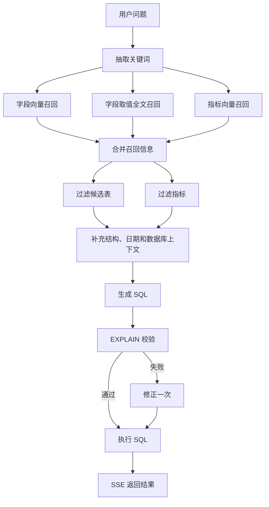

# Shopkeeper Agent

面向电商数据分析的 **自然语言问数 / Text-to-SQL** 实验项目。用户通过 React 聊天界面提出问题，后端检索字段、指标和字段取值，生成 SQL，在 MySQL 中校验并执行，通过 SSE 返回流程进度和结果表格。

项目提供 FastAPI 后端、LangGraph 工作流、元数据知识库构建脚本、演示数仓 SQL 和前端。当前处于开发阶段，首次运行需要准备基础设施、模型文件与本地配置。

## 已实现能力

- 中文关键词抽取，字段、字段取值和业务指标的多路召回。
- Qdrant 字段/指标向量检索，Elasticsearch 字段取值全文检索。
- 补齐表结构、主外键、指标定义、日期和数据库方言上下文。
- LLM 生成 SQL，MySQL `EXPLAIN` 校验，失败时修正一次，再执行查询。
- FastAPI `POST /api/query` 返回节点进度、结果和错误事件。
- React 前端显示执行步骤和结果，支持示例问题、清空消息和停止请求。

前端保存当前页面的消息列表，后端每次只接收一个 `query`，没有持久化会话或多轮历史推理。结果直接来自 SQL，没有额外的 LLM 分析报告阶段。

## 工作流程



图对应 [app/agent/graph.py](app/agent/graph.py)。修正后直接进入执行节点，没有再次校验或无限重试循环。

## 技术栈

| 层 | 组件 |
| --- | --- |
| 后端 | Python 3.14、FastAPI、LangChain、LangGraph |
| 数据库 | MySQL 8、SQLAlchemy、asyncmy |
| 检索 | Qdrant、Elasticsearch 8 + IK 中文分词 |
| Embedding | Hugging Face TEI，配置为 `BAAI/bge-large-zh-v1.5` |
| 前端 | React 19、TypeScript、Vite 6、Tailwind CSS 3、Lucide |
| 依赖管理 | uv、pnpm，以及各自锁文件 |
| 基础设施 | Docker Compose；Kibana 辅助查看 Elasticsearch |

## 项目结构

```text
app/
├── agent/              图编排、状态、上下文、节点
├── api/                路由、请求结构、依赖、生命周期
├── clients/            外部服务客户端
├── conf/               YAML 加载和结构化配置
├── core/               日志与请求上下文
├── entities/           业务实体
├── models/             元数据库 ORM 模型
├── prompt/             提示词加载
├── repositories/       数据访问与检索
├── scripts/            知识库构建入口
└── services/           构建和查询服务
conf/                   app_config.yaml、meta_config.yaml
docker/                 Compose、MySQL 初始化 SQL
frontend/               React 问数界面
prompts/                召回、过滤、生成和修正提示词
main.py                 FastAPI 入口 main:app
src/shopkeeper_agent/   打包入口，当前只打印问候语
```

`docker/elasticsearch/`、`docker/embedding/` 被 Git 忽略，不包含在克隆结果中，需要另外准备。

## 环境要求

- Git、uv 和 Python 3.14：`.python-version` 指定 3.14，`pyproject.toml` 要求 `>=3.14`。
- Node.js 20.19+ 或 22.12+，与前端 React 插件匹配；项目声明 `pnpm@10.33.0`。
- Docker / Docker Compose，或自行提供 MySQL、Qdrant、Elasticsearch 和 Embedding 服务。
- 可用的 OpenAI 兼容聊天模型服务，模型名、API Key 和 Base URL 必须匹配。

仓库没有后端应用镜像；以下步骤是在主机运行 Python 和前端，Docker 提供基础设施。

## 本地运行

### 1. 获取代码和依赖

```bash
git clone https://github.com/RRRRUA/shopkeeper-agent.git
cd shopkeeper-agent
uv sync --locked
```

从仓库根目录执行后端命令。`uv run shopkeeper-agent` 当前仅打印问候语，不会启动 Web 服务。

### 2. 准备基础设施

先核对 [docker/docker-compose.yaml](docker/docker-compose.yaml)：

| 服务 | 主机端口 | 容器端口 | 说明 |
| --- | --- | --- | --- |
| MySQL | 3307 | 3306 | 初始化 `meta`、`dw` |
| Elasticsearch | 9200 | 9200 | 需要自定义镜像和 IK 插件 |
| Kibana | 5601 | 5601 | 按需运行 |
| Qdrant | 6333 / 6334 | 6333 / 6334 | HTTP / gRPC |
| Embedding | 8081 | 80 | CPU TEI，挂载本地模型 |

启动前补齐两项资源：

1. 准备 `docker-elasticsearch:latest` 镜像，或调整 Compose 镜像名称。镜像必须包含与 ES 版本匹配的 IK 插件，索引使用 `ik_max_word`；Kibana 配置为 8.19.10，ES 版本也需对齐。仓库没有提供镜像构建文件。
2. 将完整的 `BAAI/bge-large-zh-v1.5` 模型放入 `docker/embedding/bge-large-zh-v1.5/`，与挂载路径对应。向量维度配置为 1024，必须与实际模型一致。

准备好后执行：

```bash
docker compose -f docker/docker-compose.yaml up -d
docker compose -f docker/docker-compose.yaml ps
```

MySQL 初始化 SQL 只在新数据卷首次初始化时执行，现有卷不会自动重新导入。`docker/mysql/*.sql` 含建库和删表语句，重新执行前确认数据用途。

**端口需要调整：**应用配置目前连接 MySQL 3306。使用这份 Compose 并在主机运行后端时，把 `db_meta.port`、`db_dw.port` 都改为 **3307**，并让用户、密码和授权与初始化脚本一致。

### 3. 配置模型与服务

编辑 [conf/app_config.yaml](conf/app_config.yaml)：

- `db_meta` / `db_dw`：元数据库和数仓的连接。
- `qdrant`：地址、端口、向量维度。
- `embedding`：TEI 地址和端口；实际模型由服务端加载。
- `es`：服务地址；取值仓储使用固定索引 `value_index`，不采用配置中的 `es.index_name`。
- `llm`：模型名、API Key、Base URL。当前模型名和代理地址是已有配置，不代表已验证的服务。

加载器读取根目录 `.env`，但只有 YAML 使用 `${oc.env:变量名}` 才会引用它。仅新增 `.env` 不会覆盖写死的值。例如在本地修改：

```yaml
llm:
  model_name: ${oc.env:LLM_MODEL}
  api_key: ${oc.env:LLM_API_KEY}
  base_url: ${oc.env:LLM_BASE_URL}
```

再设置相应环境变量或 `.env`，填入服务商实际值。根目录 `.gitignore` 当前未忽略 `.env` 和 `logs/`，使用时先补充忽略规则。现有 MySQL 凭据是开发示例，连接真实数据需单独配置。

### 4. 构建元数据知识库

初始化后的 `meta` 主要提供空表结构，需要继续构建知识库：

```bash
uv run --locked python -m app.scripts.build_meta_knowledge --conf conf/meta_config.yaml
```

脚本读取表字段与指标配置，从 `dw` 补齐字段类型和示例值，写入 `meta`；随后构建 Qdrant 的 `column_info_collection`、`metric_info_collection`，并将 `sync: true` 字段的取值写入 ES `value_index`。

构建不是全流程幂等操作：MySQL 使用新增写入，Qdrant 使用随机 UUID，重复运行可能出现主键冲突或重复向量。已有数据时先制定迁移方案。

### 5. 启动后端

```bash
uv run --locked python -m uvicorn main:app --host 127.0.0.1 --port 8000
```

OpenAPI 文档：`http://127.0.0.1:8000/docs`。客户端初始化或文档能打开，不代表各外部服务和实际查询已验证。

### 6. 启动前端

在另一终端进入 `frontend/`：

```bash
pnpm install --frozen-lockfile
pnpm dev
```

默认访问 `http://localhost:5173`，以终端输出为准。Vite 代理将 `/api` 转发到 `http://127.0.0.1:8000`。可复制 `frontend/.env.example` 为 `frontend/.env`：

```dotenv
VITE_API_BASE_URL=
VITE_DEV_PROXY_TARGET=http://127.0.0.1:8000
```

若 pnpm 提示 `esbuild` 构建脚本未获准，运行 `pnpm approve-builds`，选择 `esbuild` 后重新安装或构建。前端说明见 [frontend/README.md](frontend/README.md)。

示例问题：统计华北地区销售总额；按会员等级统计 2025 年第一季度订单数和销售额；查询华东地区销售额最高的前 5 个商品。请让时间范围与演示数据对应，相对日期使用后端系统日期。

## API 与 SSE

请求：`POST /api/query`，JSON 请求体：

```json
{"query": "统计华北地区的销售总额"}
```

Windows PowerShell 可使用 `curl.exe` 消费流：

```powershell
curl.exe -N -X POST http://127.0.0.1:8000/api/query -H "Content-Type: application/json" --data-raw '{"query":"统计华北地区的销售总额"}'
```

响应为 `text/event-stream`，每条消息以 `data:` 开头，以空行分隔：

```text
data: {"type":"progress","step":"抽取关键词","status":"running"}

data: {"type":"progress","step":"抽取关键词","status":"success"}

data: {"type":"result","data":[{"销售总额":12345}]}

data: {"type":"error","message":"错误原因"}
```

数值仅为结构示例。进度状态有 `running`、`success`、`error`。流开始后的异常通过 `error` 事件返回，不一定是非 200 HTTP 状态；接口使用 POST，前端通过 `fetch` 消费，原生 `EventSource` 不能直接替代。

当前 SSE 不返回生成的 SQL 文本，SQL 和结果记录在后端日志中。

## 构建与部署

```bash
cd frontend
pnpm build
pnpm preview
```

`build` 先检查 TypeScript，再输出 `frontend/dist/`；`pnpm lint` 目前也是 TypeScript 检查，不是独立 ESLint 流程。

生产环境需分别部署 Python 应用和前端静态文件。Vite 开发代理不包含在 `dist/` 中；同域部署时配置 `/api` 反向代理，并让 SSE 及时传输。跨域可在构建前设置 `VITE_API_BASE_URL`，但后端当前没有 CORS 配置，还需允许对应来源。

## 当前限制

- `EXPLAIN` 只检查 SQL 可解析性，提示词中的“仅查询”不是权限隔离。执行模型 SQL 的数仓连接应使用只读账号；演示初始化 SQL 当前授予较宽权限。
- 接口没有认证、租户隔离、统一查询超时或结果行数限制，适合先在本地演示数据使用。
- 修正 SQL 后直接执行，未再次校验；业务口径仍需与预期结果核对。
- `conf/meta_config.yaml` 的 AOV 描述指向平均订单金额，但相关字段只列 `order_quantity`，需要先核对定义。
- 字段示例值进入模型上下文，日志保存 SQL 与结果，接入真实数据时需确认访问范围。
- 前端停止请求中断浏览器接收，当前没有独立的数据库取消查询机制。

## 验证记录

本次文档更新（2026-10-13）：

- 66 个 Python 源码文件通过语法检查。
- Compose 配置可解析出 5 个服务。
- Node.js 24.12.0、pnpm 11.25.0 下，批准 `esbuild` 后前端 TypeScript 检查和生产构建通过；声明的 pnpm 10.33.0 未单独验证。
- 已找到 Python 3.14，`uv sync --locked` 因下载构建依赖 `uv-build` 超时而失败，后端完整依赖安装及应用导入尚未验证。
- 未启动外部服务、未调用收费 LLM、未执行真实端到端问数；语法检查和前端构建不代表查询结果正确。

## 参与开发

通过功能分支提交。修改节点时保持 state、runtime context 和 SSE 事件结构一致；修改数仓或指标时同步更新 SQL、元数据和预期结果。提交前检查 `git diff`，运行对应验证，避免提交密钥、模型缓存、日志和数据库数据。

## 许可证

仓库当前未提供根目录许可证文件。复用或分发前与维护者确认授权，第三方依赖和模型遵循各自许可证。
